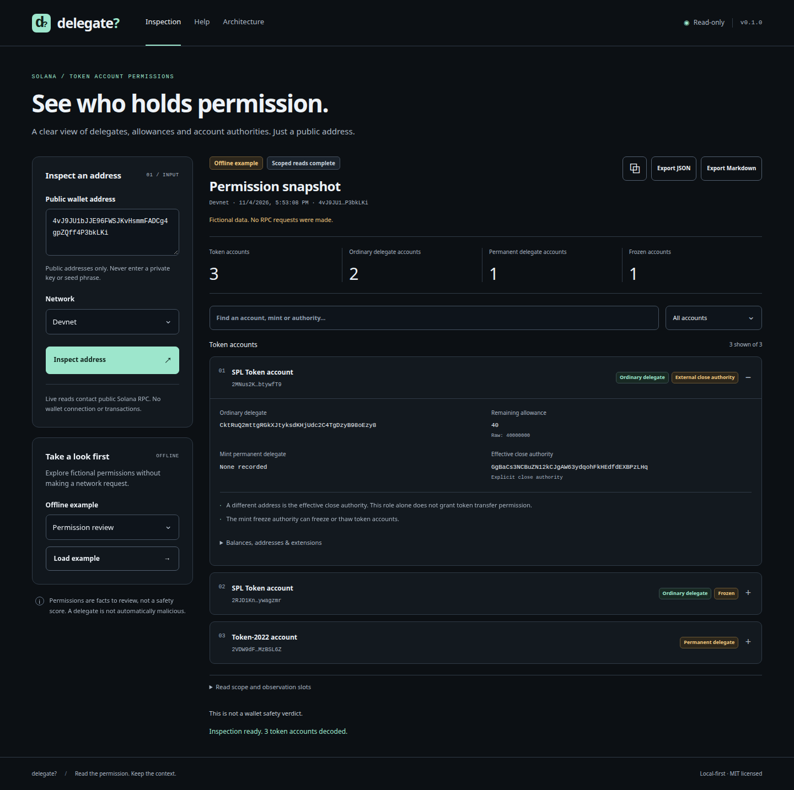

# delegate?

[](https://github.com/royalpinto007/delegate-inspector/actions/workflows/ci.yml)

See the permissions recorded on a Solana address’s token accounts.



[MIT](LICENSE) · [Architecture](docs/architecture.md) · [Reading the report](docs/guide.md) · [Verification](docs/verification.md)

```sh
git clone https://github.com/royalpinto007/delegate-inspector.git
cd delegate-inspector
npm install
npm run demo
```

Open **http://127.0.0.1:4480**. Requires Node.js **22.18+**.

- Inspect SPL Token and Token-2022 accounts on Mainnet or Devnet.
- Read ordinary delegates, exact allowances, close authority and frozen state.
- Check mint-level permanent delegates and freeze authority.
- Try four offline examples. Search, filter, copy and export JSON or Markdown.
- Keep missing reads and unsupported extensions visible.

**This is not a wallet safety verdict.** Other program permissions, multisig signer rules, historical approvals and most Token-2022 extensions are outside scope.

### CLI

```sh
npm run build
npm run cli -- --example review --json
npm run cli -- PUBLIC_ADDRESS --network devnet --json
npm run cli -- --port 4490
```

Without `--json`, the CLI prints Markdown. Exit `0`: a report, including labeled partial reads. Exit `1`: lookup failure. Exit `2`: usage/server error.

### Verify

```sh
npm run check
npm run test:e2e
npm run package:check
npm audit
```

No wallet connection, signing, transactions, database, cloud backend or saved history. Live lookups send the public address to Solana’s public RPC, subject to rate limits. Examples make no RPC requests; only explicit exports save reports. The dashboard binds to loopback.

This source project is private to npm (`private: true`). No npm publication or public hosting is required to run it.
