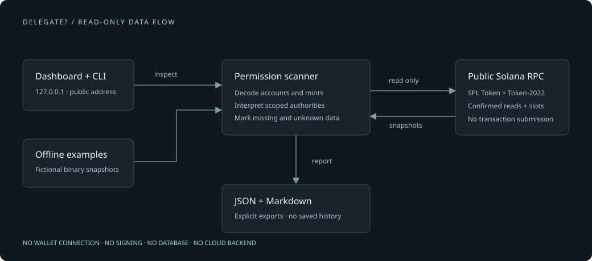
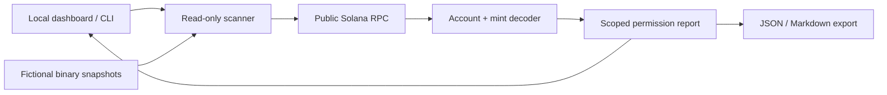

# Architecture

| Component                 | Responsibility                                                                         |
| ------------------------- | -------------------------------------------------------------------------------------- |
| `src/domain/`             | Binary layouts, exact amounts, public-address validation, report contract and Markdown |
| `src/adapters/rpc.ts`     | Fixed network endpoints, bounded responses, schema validation, timeouts                |
| `src/services/inspect.ts` | Program reads, authority matching, mint batches, coverage and diagnostics              |
| `src/examples.ts`         | Fictional bytes through the same scanner and decoder, without RPC                      |
| `src/app.ts`              | Loopback HTTP boundary, input validation, rate/concurrency limits, static assets       |
| `src/web/app.ts`          | Responsive dashboard, filters, 25-row pages, client-side exports                       |
| `src/cli.ts`              | Dashboard launcher and command-line reports                                            |

## Read flow

1. Validate the public address and network.
2. Call `getTokenAccountsByOwner` for SPL Token, then Token-2022, with base64 encoding and confirmed commitment.
3. Decode the token accounts. Require the RPC program owner and stored token-account authority to match the request.
4. Read up to 100 distinct mints using `getMultipleAccounts` batches of 50. Require the mint program to match each token account.
5. Interpret the scoped authorities. Record failed, missing, malformed and unsupported observations explicitly.
6. Return one report. Nothing is written to disk by the server.

The second program read uses the first available slot as a minimum. Mint reads use the maximum program slot as a minimum. Each actual slot is retained. **This is not an atomic snapshot.**

## Deliberate choices

- TypeScript, Express 5 and browser DOM APIs follow the existing collection’s stack without a frontend framework.
- Base64 avoids trusting a provider’s parsed extension model. u64 balances and allowances are decoded with BigInt and exported as decimal strings. No floating-point token amounts.
- Only PermanentDelegate and ImmutableOwner extensions are interpreted. All other extension IDs, names and lengths are preserved and marked unverified. An unfamiliar extension never becomes “absent.”
- Mint fetch failures retain token-account facts and raw amounts. Decimals and mint-level authorities remain unverified.
- No token metadata or arbitrary program code is fetched or executed.

## Bounds and security

- 500 accounts per program; 100 distinct mint reads; 50 mints per batch.
- 4 MiB per RPC response; 64 KiB per decoded account; 6-second timeout per read. Oversized responses are errors, not silent truncation.
- At most two concurrent dashboard lookups and 20 new lookups per minute. No automatic retry storm.
- Only two fixed HTTPS public RPC endpoints. There is no user-supplied endpoint or server-side URL fetch feature.
- Loopback binding, Host/Origin/Sec-Fetch-Site checks, CSP, JSON-only input, a 2 KiB request limit and no CORS grants.
- Runtime dependencies: Express, Helmet, Zod and bs58. No wallets, signing SDKs or private-key handling.

## References

Reviewed 4 November 2026:

- [Token account layout](https://github.com/solana-program/token/blob/main/interface/src/state.rs)
- [Token-2022 account layout](https://github.com/solana-program/token-2022/blob/main/clients/js-legacy/src/state/account.ts)
- [Extension discriminants](https://github.com/solana-program/token-2022/blob/main/clients/js-legacy/src/extensions/extensionType.ts)
- [Ordinary delegation](https://solana.com/docs/tokens/basics/approve-delegate)
- [Permanent delegation](https://solana.com/docs/tokens/extensions/permanent-delegate)
- [Account enumeration RPC](https://solana.com/docs/rpc/http/gettokenaccountsbyowner)
